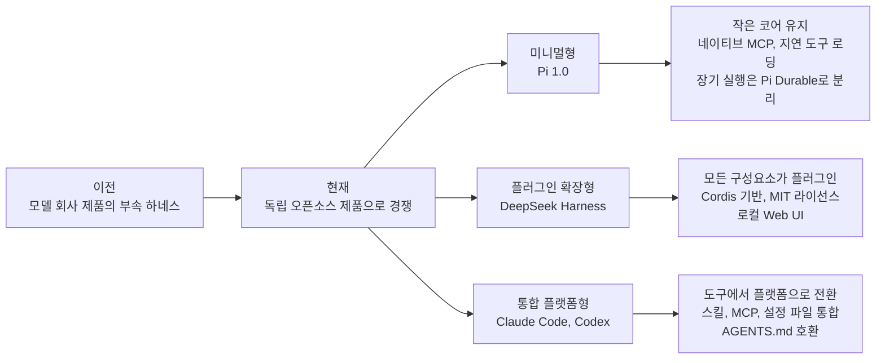
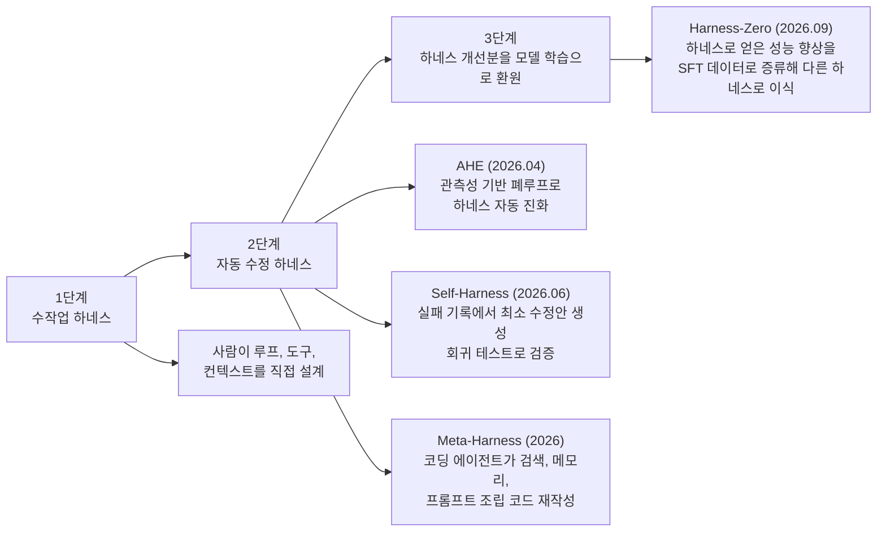
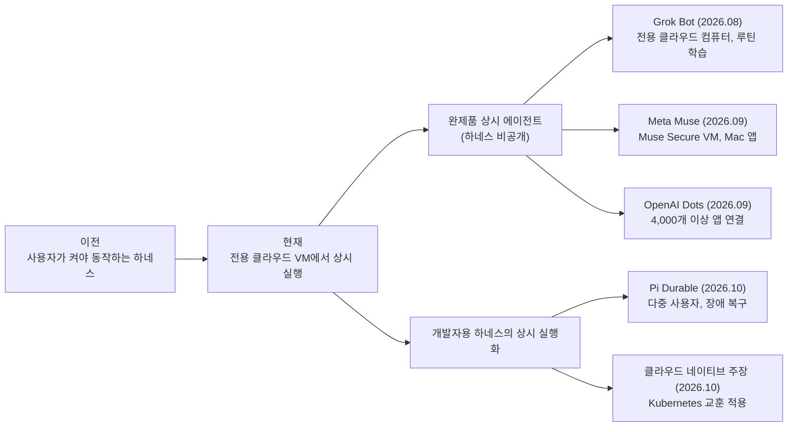

# 00. 하네스 8대 동향 (2026년 10월 12일 기준)

## 1. 하네스는 모델을 감싸는 코드에서 핵심 플랫폼 계층으로 이동 중

!!! abstract "한눈에 보기"
    2026년 하반기 하네스는 "모델을 감싸는 보조 코드"에서 **"제품 그 자체이자 표준화·자동화·클라우드화되는 플랫폼 계층"** 으로 이동 중이다.

| #   | 동향  | 상태  |
| --- | --- | --- |
| 1   | 성능 개선의 축이 모델에서 하네스로 이동 | 정착  |
| 2   | 오픈소스 하네스가 독립 제품으로 경쟁 | 급성장 |
| 3   | `SKILL.md`·MCP·`AGENTS.md`로 스킬·설정 호환 | 진행 중 |
| 4   | 하네스 코드를 스스로 고치는 자기개선 하네스 | 연구 → 실험 |
| 5   | 클라우드에서 상시 실행되는 하네스 | 초기 상용화 |
| 6   | SDLC·마케팅 플랫폼의 하네스 재정의 | 확산  |
| 7   | 권한·승인·감사의 하네스 내재화 | 필수화 |
| 8   | 과설계 경고와 소유 vs 구매 논쟁 | 논쟁 중 |

---

## 2. 하네스의 정의와 구성: 모델을 에이전트로 만드는 런타임

- **정의:** LLM을 외부 세계와 연결하는 런타임 전체. 루프, 도구, 컨텍스트 관리, 안전 통제(safety controls), 오케스트레이션, 확장 지점을 포함한다.
- **최소 구성 4요소**
  - 에이전트 루프
  - 도구 인터페이스
  - 컨텍스트 관리
  - 통제 메커니즘
- **진화 단계:** 프롬프트 엔지니어링 → 컨텍스트 엔지니어링 → 하네스 엔지니어링
- **왜 주목받나:** 2026년 3월 LangChain이 모델을 바꾸지 않고 하네스만 개선해 Terminal Bench 2.0 순위를 30위에서 5위로 올린 사례가 대표 근거로 널리 인용된다.

```
사용자 목표
   ↓
[하네스] 시스템 프롬프트 · 도구 정의 · 컨텍스트 조립
   ↓
모델 호출 → 도구 실행(권한 게이트) → 결과 관찰 → 검증
   ↑______________________________________________↓
                  에이전트 루프 (종료 조건까지 반복)
```

---

## 3. 하네스 8대 동향

### 3.1 성능 개선의 축이 모델에서 하네스로 이동

| 구분  | 내용  |
| --- | --- |
| 무엇  | 하네스 엔지니어링이 2026년 초 독립 분야로 명명되고, 하반기에는 업계 공통 어휘가 됨 |
| 근거  | 11개 프로덕션 코딩 하네스(Claude Code, Codex CLI, Gemini CLI, OpenHands, Aider, OpenCode 등) 소스코드 분석 결과, 2026년 상반기 코딩 하네스가 "도구에서 플랫폼으로" 전환했다고 결론 |
| 설계 원칙 | Anthropic(2026.4): 모델이 이미 아는 도구 위에 구축 / 모델이 좋아지면 하네스 가정을 제거 / UX·비용·안전 경계를 신중히 설정 |
| 시사점 | 성능 개선 수단이 "더 좋은 모델"에서 "더 좋은 하네스"로 확장됨 |

### 3.2 오픈소스 하네스가 독립 제품으로 경쟁

| 프로젝트 | 시점  | 특징  |
| --- | --- | --- |
| **DeepSeek Harness (dsh)** | 2026-08-13 공개 | 모든 구성요소가 플러그인, Cordis 기반, MIT, 로컬 Web UI. 개발자 프리뷰라 호환성 깨지는 변경 예고 |
|     | 8월  | 한 달 약 19.1만 스타 증가, 월간 GitHub 트렌딩 1위 |
| **Pi 1.0 / Pi Durable (Earendil)** | 2026-10-01 | 미니멀 하네스의 안정판. Codemode·네이티브 MCP·지연 도구 로딩·Anthropic 캐시 워밍 추가. 장기 실행용은 Pi Durable로 분리 |
|     | 10월 초 | Hacker News에서 이틀 만에 1,659점 이상 |



### 3.3 `SKILL.md`·`MCP`·`AGENTS.md`로 하네스 간 스킬·설정 호환

| 항목  | 내용  |
| --- | --- |
| `SKILL.md` vs `MCP` | 분석 대상 11개 하네스 중 `SKILL.md` 스킬 채택이 9개로 MCP(8개)보다 많음 |
| `ACP` | 6개 시스템이 탑재, "하네스 호스팅"이라는 새 역할 등장 |
| `AGENTS.md` | Claude Code가 `CLAUDE.md`가 없는 프로젝트에서 `AGENTS.md`를 읽도록 지원 추가 |
| `MCP` 수용 | "MCP 없음"을 고수하던 Pi도 1.0에서 네이티브 MCP 지원 |

→ 지시문·스킬·도구 정의를 표준 포맷으로 관리하면 하네스 간 이동 비용이 낮아진다.

### 3.4 자가개선 하네스

실패 기록으로 하네스 코드를 스스로 고치는 자가개선 하네스

| 연구  | 시기  | 핵심 아이디어 |
| --- | --- | --- |
| Agentic Harness Engineering (AHE) | 2026.04 | 컴포넌트·경험·의사결정 관측성으로 하네스를 자동 진화시키는 폐루프 |
| Self-Harness | 2026.06 | 자기 실패 기록에서 최소 수정안을 만들고 회귀 테스트로 검증 |
| Meta-Harness | 2026 | 코딩 에이전트가 고정 모델 주변의 검색·메모리·프롬프트 조립 코드를 재작성, 가중치 변경 없이 Terminal-Bench 2 최고 성능 |
| Harness-Zero | 2026.09 | 하네스로 얻은 이득을 SFT 데이터로 증류해 다른 하네스로 이식 |



### 3.5 상시 실행 에이전트 경쟁: 하네스를 클라우드 VM째 제품화

| 제품  | 출시  | 실행 환경 | 특징  | 상태  |
| --- | --- | --- | --- | --- |
| **xAI Grok Bot** | 2026-08-11 | 에이전트마다 전용 클라우드 컴퓨터 | 사용자 계정으로 기존 도구에 로그인, API·MCP가 없는 서비스도 화면 조작으로 처리. 한 번 시연하면 루틴으로 기억. 여러 Bot이 서로 메시지로 업무 분담 | 베타. SuperGrok·Cursor 구독에 포함 |
| **Meta Muse** | 2026-09-08 | Muse Secure VM (에이전트와 사용자 데이터를 함께 담는 전용 VM) | 일정·쇼핑·이메일 등 개인 업무 대행. 9/17 Mac 앱으로 로컬 앱 조작, 9/29 소상공인용으로 확장 | 미국 출시. 사용자만 키를 가진 Confidential VM 연내 예정 |
| **OpenAI Dots** | 2026-09-29 | Dot마다 자체 클라우드 컴퓨터·브라우저 | 4,000개 이상 앱 연결, 로그오프 후에도 작업 지속. 기업용 specialist Dots는 자체 신원·자격증명 보유 | DevDay 발표 |

**하네스 관점에서 본 공통 구조 (4요소 기준)**

| 요소  | 공통 구현 |
| --- | --- |
| 에이전트 루프 | 사용자 세션과 분리돼 클라우드에서 계속 실행 |
| 도구 인터페이스 | API 연동 + 브라우저·화면 조작(computer use)으로 API 없는 서비스까지 처리 |
| 컨텍스트 관리 | 세션을 넘는 장기 기억, 시연으로 배운 루틴 |
| 통제 메커니즘 | 승인이 필요할 때만 사용자 호출, 자동 검토, 에이전트 전용 VM으로 격리 |



### 3.6 권한·승인·감사의 하네스 내재화

| 항목  | 내용  |
| --- | --- |
| 자동 검토 | Dots는 계정에 영향을 주거나 정보를 공유하는 행동을 사용자 규칙·안전 요건에 비춰 auto-review로 점검 |
| 강제 중단 | 안전 우려 감지 시 모니터링 시스템이 Dot을 일시정지·중단 가능 |
| 에이전트 신원 | 기업용 specialist Dots는 자체 신원·자격증명·시스템 접근권 보유, Microsoft Agent 365 거버넌스 통합 추진 |
| 권한 정책 | Claude Managed Agents 권한 정책 업데이트 |

- **흐름:** 권한·승인·감사는 프롬프트가 아니라 하네스의 결정론적 게이트에서 처리하는 것이 표준 관행으로 자리잡는 중.

### 3.7 과설계 경고와 소유 vs 구매 논쟁

| 논점  | 내용  |
| --- | --- |
| 과설계 경고 | 하네스 담론이 코딩·개인 에이전트 같은 극단적 사례에 쏠려, 대부분의 빌더가 불필요한 인프라를 짓고 있다는 지적 |
| 소유 vs 구매 | "하네스가 곧 회사인가"를 두고 직접 소유해야 한다는 주장과 HN 반론이 10월 초 화제 |

## 4. 관찰 중인 신호

근거가 아직 한 곳뿐이라 동향으로 보기 이른 움직임이다.

| 신호  | 근거  | 아직 동향이 아닌 이유 |
| --- | --- | --- |
| '하네스'라는 말이 개발 도구 밖 업무 소프트웨어로 확산 | Yext (2026-10-08) | 한 회사의 자체 발표이며, 기존 자산을 하네스로 재명명한 성격이 강하고 아직 대기자 명단 단계 |

### 4.1 Yext: 마케팅 플랫폼의 "멀티플레이어 에이전트 하네스"


기업과 매장의 위치·영업시간·리뷰 같은 브랜드 정보를 검색엔진, 지도, AI 검색에 일관되게 내보내는 마케팅 플랫폼. AI 검색에서 브랜드가 얼마나 노출되는지 추적하는 Scout를 운영한다.

| 항목  | 내용  |
| --- | --- |
| 발표  | Scout를 마케터용 "멀티플레이어 에이전트 하네스"로 재정의 *현재 대기자 명단 단계 |
| Yext의 하네스 정의 | 모델을 실제 업무에 믿고 맡길 수 있게 만드는 주변 구조.  Claude와 ChatGPT도 하네스이며, 자사는 Knowledge Graph 등으로 약 10년간 마케팅용 하네스를 만들어 왔다고 주장 |
| 구성  | 메모리, 수백 개의 기본 스킬, Yext 플랫폼 안팎에서 행동하는 연결.  검증된 데이터 사용, 위험·규제 구간에 사람 개입, 모든 행동 기록 |
| "멀티플레이어"의 의미 | 본사·지역 책임자·매장 운영자가 같은 맥락을 공유하며 한 곳에서 작업.  본사가 승인한 브랜드 기준을 매장 단위 에이전트도 그대로 따름 |
| 함께 발표 | 지역별 유료 광고를 자동화하는 `Flamel.ai` 인수 계약 |

- 하네스 4요소(루프·도구·컨텍스트·통제)에는 대응되므로 개념적으로는 하네스가 맞다.  
  다만 업계 흐름이라기보다 "하네스가 업무 소프트웨어의 제품 언어로 쓰이기 시작했다"는 신호로 본다.

---

## 참고 자료

#### 출처

[Faros AI – Harness engineering guide](https://www.faros.ai/blog/harness-engineering)

[ai-boost/awesome-harness-engineering](https://github.com/ai-boost/awesome-harness-engineering)

[arXiv 2609.00006 – Harness Engineering: Source-Code Study of Eleven Systems](https://arxiv.org/abs/2609.00006)

[arXiv 2604.25850 – Agentic Harness Engineering](https://arxiv.org/abs/2604.25850)

[deepseek-ai/deepseek-harness](https://github.com/deepseek-ai/deepseek-harness)

[KOCPC – DeepSeek Harness 오픈소스 공개](https://en.kocpc.com.tw/?p=24435)

[Analytics Vidhya – Top 10 GitHub Repos Trending in August 2026](https://www.analyticsvidhya.com/blog/2026/09/top-github-repositories-august-2026/)

[Let's Data Science – Pi 1.0 Adds MCP Support](https://letsdatascience.com/news/pi-10-adds-mcp-and-durable-harness-6241c6f7)

[DevToolLab – Pi 1.0 Explained](https://devtoollab.com/blog/what-is-an-agent-harness)

[Claude Code / Platform 변경 추적 (GitHub Issue)](https://github.com/ClaySecAI/claude-enterprise-control-baseline/issues/20)

[DAIR.AI Academy – Harness Engineering Paper Collection](https://academy.dair.ai/papers/collections/harness-engineering)

[BetaNews – OpenAI dots](https://betanews.com/article/openai-dots-agents-chatgpt/)

[The New Stack – OpenAI just launched Dots](https://thenewstack.io/openai-dots-gpt6-agents/)

[The New Stack – Kubernetes' "monolith" lesson for AI agent harnesses](https://thenewstack.io/kubecon-agent-harness-koordinator/)

[Harness 보도자료 – Harness Acquires Augment Code](https://www.harness.io/press-and-news/harness-acquires-augment-code)

[Harness 블로그 – Cosmos Software Factory Agent](https://www.harness.io/blog/harness-acquires-augment-code-cosmos)

[The New Stack – Harness bought Augment's coding agents](https://thenewstack.io/harness-augment-cosmos-acquisition)

[Yext – Envision 2026 Recap](https://www.yext.com/blog/yext-envision-2026-recap)

[WikiDocs – 에이전트 하네스를 과설계하지 마라](https://wikidocs.net/blog/@jaehong/27031/)

[explainx.ai – What Is an Agent Harness? (10월 업데이트)](https://explainx.ai/blog/what-is-agent-harness-complete-guide-2026)

[Harness 블로그 – Everything Shipped in September 2026](https://www.harness.io/blog/shipped-in-september-2026)

#### 영상

[AI Harness Engineering – Forward Deployed Engineering Tutorial](https://www.youtube.com/watch?v=tYchws8hpd8)

[What is harness engineering? – Thoughtworks Technology Podcast](https://www.youtube.com/watch?v=KQJLPsbnKiQ)

---

<small>기준일: 2026-10-12</small>
